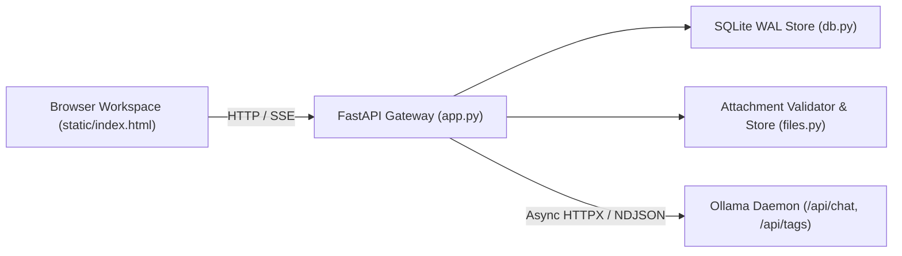

# LocalAI Studio

Self-hosted web workspace and REST/SSE gateway for managing and interacting with local [Ollama](https://ollama.com/) language and vision models.

## Purpose & Problem Statement

Command-line model runners make multi-turn context management, parameter tuning, system prompt reuse, and file or image inspection cumbersome for daily engineering workflows. Cloud wrappers introduce external telemetry and privacy concerns. LocalAI Studio provides a self-hosted workspace backed by SQLite so model execution, conversation state, reusable prompts, and file attachments stay on your own host or local network.

## Features

- **Ollama Model Management**: List installed models, inspect modelfiles/metadata, pull new models, and delete unused models.
- **Streaming & Synchronous Chat**: Real-time token streaming via Server-Sent Events (SSE) and synchronous JSON responses.
- **Conversation Lifecycle**: Create, rename, switch models, tune sampling parameters (`temperature`, `top_p`, `top_k`, `num_ctx`, `repeat_penalty`), and delete persistent conversations.
- **System Prompt Presets & User Preferences**: Save/reuse named system prompts and persist UI theme and model defaults in SQLite.
- **Validated File & Vision Attachments**: Upload UTF-8 text/code files and images (`.png`, `.jpg`, `.webp`, `.gif`) with magic-byte validation, NUL-byte rejection, size limits, and UUID-based storage paths.
- **Docker & Compose Ready**: Single-command deployment pairing LocalAI Studio with Ollama.

## Tech Stack

- **Backend**: Python 3.11+, FastAPI, Uvicorn, HTTPX, aiosqlite, Pydantic v2
- **Database**: SQLite in WAL mode with foreign-key cascading
- **Frontend**: Vanilla HTML/CSS/JavaScript (dark/light theme, zero frontend build pipeline)

## System Requirements

- Python 3.11 or newer
- Running Ollama daemon (local or containerized)

## Installation

```bash
git clone https://github.com/fully-ai/localai-studio.git
cd localai-studio
python3 -m venv .venv
source .venv/bin/activate
pip install -e ".[dev]"
```

## Configuration

Copy `.env.example` to `.env` to override runtime settings:

| Variable | Default | Description |
| --- | --- | --- |
| `LOCALAI_HOST` | `127.0.0.1` | Server bind address |
| `LOCALAI_PORT` | `8080` | HTTP listen port |
| `LOCALAI_OLLAMA_BASE_URL` | `http://127.0.0.1:11434` | Ollama REST API base URL |
| `LOCALAI_OLLAMA_TIMEOUT_SECONDS` | `120.0` | Upstream Ollama request timeout |
| `LOCALAI_DATA_DIR` | `./data` | SQLite database and attachment directory |
| `LOCALAI_MAX_UPLOAD_BYTES` | `10485760` | Maximum attachment size in bytes (10 MiB) |
| `LOCALAI_DEFAULT_MODEL` | `llama3.2` | Default model identifier |
| `LOCALAI_CORS_ORIGINS` | `["http://127.0.0.1:8080","http://localhost:8080"]` | Allowed CORS origins |

## Running & Usage Examples

Start the server:

```bash
localai-studio
```

Open `http://127.0.0.1:8080`, or interact via the REST API:

```bash
# Check Ollama connectivity
curl -s http://127.0.0.1:8080/api/health

# Create a conversation
curl -s -X POST http://127.0.0.1:8080/api/conversations \
  -H 'Content-Type: application/json' \
  -d '{"title":"Code Audit","model":"llama3.2","system_prompt":"Be concise."}'

# Send a non-streaming message
curl -s -X POST http://127.0.0.1:8080/api/conversations/<conv_id>/messages \
  -H 'Content-Type: application/json' \
  -d '{"content":"Explain SQLite WAL mode.","stream":false}'
```

## API Documentation

| Method & Path | Description |
| --- | --- |
| `GET /api/health` | Application status and Ollama reachability check |
| `GET /api/models` | List models available in Ollama |
| `POST /api/models/pull` | Pull a model (`{"name": "llama3.2"}`) |
| `GET /api/models/{name}` | Inspect model metadata |
| `DELETE /api/models/{name}` | Remove a model from Ollama |
| `GET /api/conversations` | List conversations ordered by recent activity |
| `POST /api/conversations` | Create conversation with model, prompt, and parameters |
| `GET /api/conversations/{id}` | Retrieve conversation details and full message history |
| `PATCH /api/conversations/{id}` | Update title, model, system prompt, or parameters |
| `DELETE /api/conversations/{id}` | Delete conversation and cascade-delete messages |
| `POST /api/conversations/{id}/messages` | Submit user prompt (returns SSE stream when `stream=true`) |
| `POST /api/files` | Upload validated text/code or image attachment |
| `GET /api/prompts` / `POST /api/prompts` / `DELETE /api/prompts/{id}` | Manage reusable system prompt presets |
| `GET /api/preferences` / `PATCH /api/preferences` | Read and update UI/model preferences |

## Architecture



## File Structure

```
localai-studio/
├── src/localai_studio/
│   ├── app.py            # FastAPI routes and SSE streaming bridge
│   ├── config.py         # Pydantic environment settings
│   ├── db.py             # Async SQLite repository
│   ├── files.py          # Extension, magic-byte, and UTF-8 upload guard
│   ├── ollama_client.py  # Async Ollama REST client
│   ├── schemas.py        # Request/response schemas
│   ├── main.py           # CLI entrypoint
│   └── static/           # Web interface (index.html, app.js, styles.css)
├── tests/                # Unit and ASGI integration tests
├── docs/architecture.md  # Detailed architecture notes
├── Dockerfile
└── compose.yaml
```

## Testing

```bash
ruff check src tests
mypy src
pytest -v
```

## Docker Deployment

```bash
docker compose up -d --build
```

## Security Notes

- Binds to `127.0.0.1` by default; place behind TLS and reverse-proxy authentication before exposing to untrusted networks.
- Uploaded files are stored under generated UUID names (`Path(raw).name` + `.resolve()` parent checks) to prevent path traversal, and images undergo header magic-byte verification.

## Known Limitations

- Single-user local workspace without built-in multi-user authentication.
- Binary document formats such as PDF are not parsed directly (use `documind` for PDF ingestion; `localai-studio` accepts UTF-8 text/code and images).

## Contributing

See [CONTRIBUTING.md](CONTRIBUTING.md) and [CODE_OF_CONDUCT.md](CODE_OF_CONDUCT.md).

## License

Apache License 2.0 — see [LICENSE](LICENSE).
